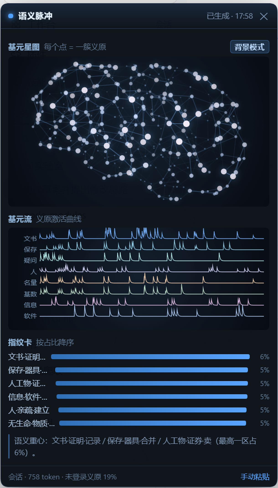
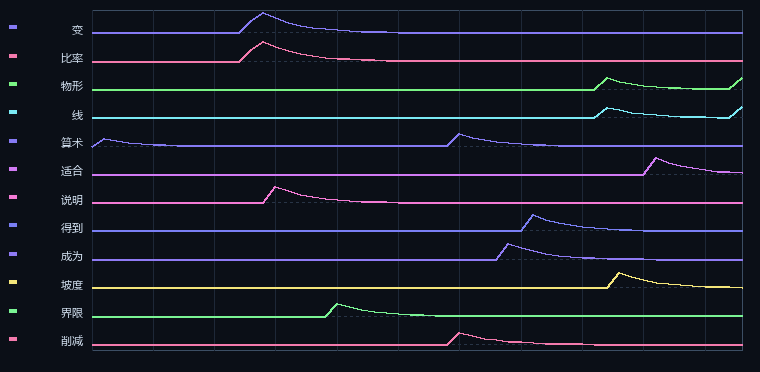

# 语义脉冲 · dsh-primitive-pulse

在 DSH 里实时看**当前这段回答**点亮了哪些语义基元。右下角一个圆钮，点开是三个面板，也可以切到全屏背景模式。



**基元星图**——340 个簇铺成立体脑形，被命中的节点变亮，两端都亮的连线更亮：


**基元流 + 指纹卡**——上面是义原沿 token 的激活曲线（脑电样式多导联），下面是按分区聚合的构成表：



| 面板 | 看什么 |
| --- | --- |
| 基元星图 | 340 个簇铺成立体脑形：被命中的节点变亮，两端都亮的连线更亮；静息时是一张暗着的网格 |
| 基元流 | 多条多导联，每条是一个义原沿 token 的激活曲线（带衰减拖尾），合成在一张脑电图纸上 |
| 指纹卡 | 义原按分区聚合后的构成表，按占比降序，和样例基线对比 |

**形状是隐喻，不是脑活动。** 面板里没有 fNIRS、没有皮层柱、没有任何神经测量；点亮的依据全部是文本经 HowNet 义原体系分解后的统计。所以页脚写的是「形状是隐喻，不是脑活动」。

## 它到底做了什么

1. 宿主把每轮 assistant 正文交给插件（`session/event` 的 `assistant/message`，不抓屏、不读你的输入）。
2. 正文用内置的中英词表切成词，每个词查 HowNet 义原（2,168 个义原 / 133,759 个中文词 / 48,042 个英文词）。
3. 逐 token 累出「义原激活流」，按指数衰减滚成曲线；同时聚成 340 个簇，投到预生成的三维坐标上。
4. 浏览器端只负责画：一个轮询 `/dsh-pulse/state`，拿到帧自己渲染。

## 装

```powershell
dsh plugin --profile web add github:DreamLoomStudio/dsh-primitive-pulse
```

装完**重启 DSH Desktop**（宿主在启动时收集一次注入行，运行期加不进来）。重启后：

- 右下角出现圆钮；点它，或按 `Ctrl+Shift+P` 展开面板；
- 想看服务端是否起来，访问 `http://127.0.0.1:43129/dsh-pulse/ping`，返回 JSON 即正常：

```json
{"ok":true,"plugin":"dsh-primitive-pulse","assets":{"widget":25630,"core":11022,"data":4348808},"seq":0,"hasText":false}
```

## 用

- **圆钮可拖动**，位置会记住。
- 面板头部「背景模式」：把星图铺到整个窗口背景，慢慢自转；再点一次关闭（也会记住）。
- 没有新回答时，面板不会空着——回放结束后会按每个节点的峰值做错相位的呼吸，让你仍能看到这段回答激活了哪些区域。
- 手动粘贴：面板底部「手动粘贴」可以贴任意文本（不用等模型回答）试一段。

## 卸载

```powershell
dsh plugin --profile web remove dsh-primitive-pulse
```

然后重启 DSH Desktop。

## 数据从哪来

- **2,168 个义原 / 133,759 个中文词 / 48,042 个英文词**：清华 [OpenHowNet](https://github.com/thunlp/OpenHowNet)（HowNet 语义词典）的义原组合，不取例句、不取词频排名。
- **补录 38 条**：HowNet 里没有的现代术语（微分、梯度、插件、面板、残差…）。
- **340 个簇**：义原共现矩阵 → 谱嵌入 → 递归二分聚类，簇名取质心最近的成员义原。
- **三维位置**：侧视剖面取样 + 半球深度 + 空间近邻网格（1,342 条边）。

词表与坐标全部离线打包在 `assets/sememe-data.js`（4.3 MB），**运行时不联网、不调模型、不上传任何内容**。

## 隐私边界

- 插件只在**服务端内存**里保留**最近一段** assistant 正文（`state.text`），进程退出即消失，不落盘、不写日志。
- 浏览器只向**本机**的 `/dsh-pulse/state` 取数据，路由先过宿主的 `connection.requestRejection` 信任栅栏（拿不到栅栏就 fail-closed）。
- 没有账号，没有统计，没有远程上报。

## 已知限制

- 宿主只推「一整条 assistant 消息」，没有逐字 delta：所以是**回答落地后回放**，不是逐字实时。
- 拿不到 `logprobs`（内核目前不暴露），所以没有「模型犹豫度」这一维。
- 多义词按 HowNet 第一个义项算，偶尔会出笑话（`把` → 把手、`世界` → 天体）。
- 未登录词会显示在底部（`未登录义原 N%`），不影响其余部分。

## 开发

```powershell
node test/smoke.mjs            # 核心链路（分词 → 义原流 → 簇帧 → 指纹）
node test/widget_headless.mjs  # 挂件 DOM/Canvas 用最小桩跑一遍
node test/english.mjs          # 英文词表
```

资产同步（如果你在本仓库之外改了 `core.js` / 词表）：`node script/sync-assets.mjs`。

MIT License · 数据来自 OpenHowNet，遵守其原始许可。
